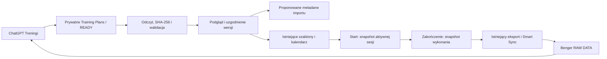

# Etap 5A — audyt i architektura integracji treningowej

Stan kodu: `feature/local-sync-export`, baza **5b51a0b**, 28.11.2026. Zaakceptowany APK: **1.0.24**. BUG-02 Phone Link pozostaje osobny i nieblokujący. Jest to **projekt do akceptacji przed 5B**, nie opis działającego importera treningów. Nie zmieniono plików aplikacji, modeli, danych, Google Cloud ani arkuszy; nie powstał nowy APK.

## 1. Wniosek architektoniczny

Wykorzystać obecne repozytorium, szablony, kalendarz i sesje. Dodać cienką warstwę publikacji i uzgadniania importowanych bloków, zamiast osobnego dziennika treningowego. Rozszerzenia są konieczne dla pochodzenia/weryfikacji wersji oraz **planowanych** RIR, ciężarów i typów serii, które nie mieszczą się dziś w `dosage`. Nie wolno ich tracić w walidatorach ani przedstawiać jako rzeczywiste wyniki.

Strzałki z publikacji do aplikacji są proponowane. Działający jest już przepływ od ręcznych planów/sesji do RAW DATA. Import nie wywołuje `start`, `set`, `completeMobilitySet` ani `finish`.

## 2. Zweryfikowane pliki

| Plik | Rzeczywista rola |
|---|---|
| `training-library.js` | Statyczne EXERCISES, EQUIPMENT; 60 ćwiczeń builtin |
| `training-model.js` | Walidatory ćwiczeń, dawkowania, szablonów, sesji, serii i timera; snapshoty, scalanie |
| `training-repository.js` | Transakcje IndexedDB; start, zapis wykonania, zakończenie, kalendarz, instalacja listopada |
| `training-ui.js` | Sześć zakładek treningu; edytory, realizacja, podgląd zakończenia, historia i biblioteka |
| `training-calendar.js` | Daty cywilne, once/weekly, wyjątki, podział reguł, status wykonania |
| `training-calendar-ui.js` | Miesiąc, tydzień i agenda; rozdzielone znaczniki planu i wykonania |
| `training-november-2026.js` | Specjalny, jednorazowy preset; nie jest uniwersalnym importerem |
| `training-reminders*.js`, `reminder-preferences.js` | Istniejące przypomnienia; bez automatycznego wykonania treningów |
| `training-voice.js`, `exercise-guide-ui.js`, `exercise-guides.js` | Wprowadzanie wykonania i istniejące instrukcje; nie katalog importu |
| `product-cache.js`, `app-storage.js` | Wspólna baza, namespace i store meta |
| `backup.js` | Backup i odzyskiwanie importu; osobne training / trainingSchedule |
| `sync-export.js`, `sheets-mapper.js` | Eksport wyłącznie ukończonych sesji, jednostki i RAW DATA |
| `sync-intents.js`, `sync-intent-proof.js`, `sheets-auto.js` | Trwałe intencje rzeczywistych zmian, dowody usunięć, sterowanie zdarzeniami |
| `recipe-import-format.js`, `recipe-file-import.js` | Wzorzec walidacji, podglądu, receipt i atomowego importu przepisów |
| `recipe-sheets-contract.js`, `meal-plan-contract.js`, `meal-plan*.js` | Wzorzec MANIFEST/CHUNK, READY, wersji i konfliktów |
| `android/.../BengerRecipeSheetsPlugin.java`, `RecipeSourceProtocol.java` | Natywny odczyt źródła; obecnie przypięty do źródła żywieniowego |

Dokumenty `docs/training.md` opisują wcześniejszy etap 12; wzmianka o pięciu zakładkach jest historyczna. Bieżący kod ma także Kalendarz. Nie należy na ich podstawie zakładać braku harmonogramu.

## 3. Mapa obecnego przechowywania

Baza `BengerDB`, IndexedDB **v3**, store `meta`, klucz `key`. Nazwy preview otrzymują osobne namespace w app-storage.js. Biblioteka builtin jest kodem, nie kopią wszystkich rekordów w IndexedDB. Trening ma prefiks `training:`; funkcja `trainingFromRecords` odrzuca nierozpoznaną nazwę kolekcji pod tym prefiksem.

| Klucz/kolekcja | Zawartość | Istotne ograniczenie |
|---|---|---|
| `training:exercises:<id>` | Własne ćwiczenie | ID custom:, max 500 |
| `training:workoutTemplates:<id>` | Zestaw workout | Max 300, items max 100 |
| `training:mobilityRoutines:<id>` | Rutyna mobility | Max 300, items max 100 |
| `training:activeWorkout` | Jedna aktywna sesja workout | Może współistnieć z aktywnym Mobility |
| `training:activeMobility` | Jedna aktywna sesja Mobility | Własny snapshot, nie odwołanie do bieżącego szablonu |
| `training:completedWorkouts:<id>` | Snapshot ukończonej sesji | Max 5000 |
| `training:completedMobility:<id>` | Snapshot ukończonego Mobility | Max 5000 |
| `training:timer` | sessionId, kind, purpose, duration, endsAt | Jeden wspólny timer dla obu rodzajów sesji |
| `training:schedule` | rules + exceptions | Max 500 reguł i 5000 wyjątków |

Limity są walidowane dla całej lokalnej kolekcji, a nie tylko przychodzącego pakietu. Import musi sprawdzić miejsce po dodaniu danych, nie usuwać istniejących planów, aby zmieścić nowy blok.

Transakcja repozytorium czyta zakres prefiksu w meta, waliduje, zapisuje zmienione rekordy i usuwa wycofane. `finish` przenosi aktywną sesję do historii oraz usuwa jej timer w tej samej transakcji. Quota/abort nie mogą pozorować udanego zapisu. Nie ma publicznej atomowej operacji „zaimportuj blok”; sekwencja saveExercise → saveTemplate → plan to wiele transakcji i nie spełni tego wymagania.

## 4. Modele i jednostki

### Ćwiczenie

`{id,name,category,mode,dumbbells,equipment,note,defaults}`. ID do 100 znaków, `[\\w:-]+`; builtin:* / custom:*. Tryby: strength, bodyweight, time, cardio, mobility. Biblioteka: 26 strength, 10 bodyweight, 1 time, 1 cardio, 22 mobility. Nazwy są mieszane językowo; brak oddzielnego EN i rejestru aliasów ćwiczeń.

**strength to dziś hantle**: wymaga 1–2 hantli i sprzętu dumbbell. Sprzęt obejmuje bodyweight, dumbbell, bench, trx, pull-up-bar, dip-bars, treadmill, band. Nie ma natywnego wsparcia sztang, maszyn ani wyciągów. Wpisanie maszyny jako strength/dumbbells=0 byłoby błędem; nie jest bezpiecznym obejściem.

### Dawkowanie i szablon

`dosage`: sets 1–100; repsMin/repsMax nullable; duration w sekundach nullable; rest 0–3600 s; side left/right/both; note, frequency, physioNote. Domyślnie sets=1, rest=60, side=both. Parser nie zachowuje dodatkowych pól. Zakres powtórzeń dawkowania dopuszcza number, ale rzeczywiste reps serii są całkowite; proponowany kontrakt planu zawęża powtórzenia do integer.

Przy swobodnym dodawaniu ćwiczenia repozytorium może podpowiedzieć poprzednią przerwę albo 90 s (workout bez cardio), 0 s dla cardio/Mobility oraz 60 s czasu ćwiczenia time. To lokalne podpowiedzi, nie wartości od autora planu. frequency w dosage jest tekstem, nie regułą kalendarza.

Szablon `{id,name,kind,note,items:[{exerciseId,dosage}]}` nie ma wersji, bloku, ID elementu, planowanego kg, RIR/RPE, tempa ani alternatyw. Edytor pozwala zmieniać kolejność, dawkowanie, duplikować i usuwać. `saveTemplate` zastępuje rekord o tym samym ID, bez trójstronnego uzgodnienia. To nie jest gotowy mechanizm aktualizacji publikacji.

### Sesja i wykonanie

`{id,name,kind,status,date,startedAt,completedAt?,index,note,before,after,items,scheduled?,routineBased?}`. Element zawiera **kopię** ćwiczenia i dosage, `sets` oraz `completedSets`. Nie ma ID elementu: eksport rozróżnia powtórzone ćwiczenia przez pozycję.

Start kopiuje szablon. Dalsza edycja/usunięcie szablonu nie przelicza istniejącego snapshotu. Zakończenie wymaga rzeczywistego zapisu co najmniej jednej serii workout lub zaliczonej serii Mobility. Ręczny start używa daty lokalnej urządzenia; kalendarz pozwala rozpocząć zaplanowaną jednostkę tylko dzisiaj. Planowanie przyszłych dat nie tworzy wykonania.

Seria ma własne ID i kind work/warmup:

| Tryb | Zapis wykonania | Jednostki i limity |
|---|---|---|
| strength | kg wymagane, reps wymagane, RIR opcjonalny | kg **jednego hantla**, 0–40; reps integer 1–1000; RIR 0–10 |
| bodyweight | reps wymagane, kg i RIR opcjonalne | kg oznacza wyłącznie dodatkowy ciężar 0–200; brak kg nie jest wpisaną masą ciała |
| time | duration wymagane | Sekundy 1–86400, brak osobnego kg |
| cardio | duration i distance wymagane, speed/incline opcjonalne | s; km 0–500; km/h 0–50; nachylenie % -20…50 |
| mobility | licznik completedSets | Nie zapisuje tablicy rzeczywistych serii z kg/reps każdej serii |

Rzeczywista seria nie ma RPE, tętna ani tempa. Dla czasu, np. farmer carry, nie ma osobnego pola obciążenia. Nie należy dowolnie przeliczać RPE na RIR. Dla jednostronnych ćwiczeń nie ma oddzielnego wyniku L/R każdej serii; side opisuje dawkowanie. Nie podwajamy objętości za strony.

Objętość strength: kg jednego hantla × dumbbells × reps; bodyweight: tylko dodatkowe kg × reps. Warmup nie zwiększa objętości roboczej. Podsumowanie cardio liczy wpisy cardio oddzielnie, zanim rozpatrzy kind — rozgrzewka cardio nie staje się automatycznie liczbą siłowych serii rozgrzewkowych. Nie wyliczamy spalonych kalorii ani 1RM.

### Mobility

Ten sam silnik repozytorium i kalendarza, osobne rutyny i sesje. Każde zaliczenie zwiększa completedSets; czasomierz nie zapisuje sam wykonania. Dawkowanie ma stronę, liczbę serii/powtórzeń lub czas, przerwę, wskazówki i notatkę fizjoterapeuty. Oceny before/after zawierają własne notatki oraz wellbeing/stiffness/discomfort 0–10. To prywatny dziennik, nie automatyczna ocena kliniczna. routineBased odróżnia rutynę od sesji swobodnej; starsze rekordy mają zachowany fallback.

## 5. Harmonogram i wersjonowanie lokalne

Reguła: `{id,kind,templateId,title,startDate,time,recurrence,note,createdAt,updatedAt}`. recurrence once lub weekly, weekday poniedziałek=0…niedziela=6, until nullable. Wyjątek skip identyfikuje ruleId+date. Daty są cywilne, bez przesuwania ich przez UTC; czas opcjonalny HH:mm.

Wystąpienia weekly są wyliczane, klucz widoku to rule.id@date. `splitSchedule` tworzy nową regułę od wskazanej daty, pozostawiając wcześniejszą część; wyjątki są zachowane w odpowiednim zakresie. `scheduled:{ruleId,date}` w sesji jest samodzielnym pochodzeniem i musi odpowiadać jej date. Nie wymaga, aby reguła wciąż istniała. Kalendarz nanosi ukończone sesje niezależnie od planów, po dacie rzeczywistej sesji.

Przesunięcie daty zmienia rule.id@date, więc klucz wystąpienia weekly nie jest wystarczającym zewnętrznym identyfikatorem importu. W v1 proponujemy jednostki z konkretną datą i stabilnym ID niezależnym od daty. Nie importujemy nieograniczonej reguły weekly jako niejawnego nieskończonego bloku.

## 6. Istniejący import, migracje i backup

- `installNovemberPlan` / buildNovember2026 to jednorazowy, addytywny instalator statycznego planu: 22 definicje custom, 24 szablony workout, 30 rutyn Mobility i 54 reguły konkretnych dat. To liczby generatora w kodzie, **nie odczyt prywatnej bazy użytkownika**.
- hasNovember2026 blokuje ponowne instalowanie, żeby nie wskrzesić usuniętych dat i nie nadpisać zmian. RPE, progresja i deload są w dużej części tekstem lub materiałem generatora; blok nie jest zapisaną, wersjonowaną encją.
- Backup importuje/scala treningi i harmonogram. `mergeTraining`/mergeSchedule zachowują istniejący rekord przy konflikcie ID i nie wskrzeszają ukończonej sesji jako aktywnej. Nie są aktualizatorem wersji planu.
- Bieżący backup eksportuje v8, a gdy jest stan jadłospisów — v9. Czyta wersje 1–9. `data.training` zawiera własne ćwiczenia, szablony/rutyny, aktywne i ukończone sesje oraz timer. Kalendarz jest wydzielony jako `data.trainingSchedule` (od v7). Builtiny nie są prywatną kopią danych użytkownika.
- Backup ma walidację, journal odzyskania i rollback. Rozszerzenie danych planów w przyszłości wymaga **jawnego objęcia backupem**, a nie polegania na nieznanym kluczu meta. Starszy walidator usuwa dodatkowe pola z modeli.

## 7. Eksport wykonania i Smart Sync

sync-export.js waliduje tylko completedWorkouts i completedMobility. Zaplanowane i aktywne jednostki nie trafiają do eksportu. Serie zachowują work/warmup, kg/reps/RIR, null zamiast brakującej miary, basis per-dumbbell/additional-load, sekundy/km/km/h/%. Pochodzenie scheduledRuleId/date jest zachowane. Notatki, opisy fizjoterapeuty i oceny prywatne nie są kopiowane do RAW DATA.

Mapper tworzy: Treningi — sesje; Serie — rekord ćwiczenia i jego rzeczywiste serie; Mobility — sesję i ćwiczenia z planowanym dosage oraz liczbą completedSets. To, że przy **ukończonej** sesji eksportowane są pola plannedSets, nie oznacza eksportu nieodbytego planu. Surowy plan nie może trafić do tych zakładek.

Repozytorium zapisuje intencje tylko dla zmian completedWorkouts/completedMobility, nie dla usunięcia szablonu lub przesunięcia planu. Proof wiąże usuwane wiersze sesji/serii z poprzednim stanem. BUG-03 usunięty: czysta kolejka nie krąży co 1,5 s. Przyszły import musi zachować te zabezpieczenia; nie może uznawać braku ukończonej sesji w pakiecie planu za jej usunięcie.

## 8. Mapa wsparcia docelowych pól

| Wymaganie | Dziś | Rekomendacja |
|---|---|---|
| Blok, wersja, cel, tygodnie/deload | Brak encji bloku | Metadane importu poza training: |
| Jednostka, data/czas, kolejność | Szablon + kalendarz | Użyć obecnych, dodać stabilne źródłowe ID i wersję |
| Rozgrzewka / typy serii | Rzeczywisty kind; brak typowanych celów | Planowane phase/setKind w sidecar, obsługa przy realizacji w 5B/5C |
| Serie, rep range, czas, przerwa, strona | Dosage | Jawna projekcja bez domyślnego zamieniania null na 0 |
| Planowane kg / RIR | Brak w dosage; są rzeczywiste kg/RIR | Przechować i pokazać jako cele, nie gotowe wykonane serie |
| RPE, tempo, technika, alternatywy, progresja | Tekst lub brak | Typowane metadane planu + jawny UX; żadnej automatycznej progresji |
| Hantle i dodatkowe obciążenie bodyweight | Obsługiwane z limitami | Zachować istniejącą semantykę kg |
| Sztangi/maszyny/wyciągi, >40 kg/hantel | Nieobsługiwane | Osobny zatwierdzony etap modelu, objętości, UI i RAW DATA; blokada capability zamiast obejścia |
| Cardio target distance/speed/incline | Tylko wykonanie ma te pola | Planowane cele osobno, jednostki jak istniejące |
| Pace, intensywność, HR zone | Brak struktury wykonania | W planie informacyjne cele; capability/UX; nie wymyślać tętna |
| Oddzielne rzeczywiste serie L/R i Mobility | Brak | Opcjonalny późniejszy etap; nie rekonstruować nieistniejącej historii |
| Nazwy PL/EN i aliasy | Jedna nazwa, brak alias registry | Katalog opisany w osobnej specyfikacji |
| Wersje źródła i lokalne konflikty | Brak | Base/local/remote + trwałe receipts/overrides |

## 9. Architektura proponowanego rozszerzenia

Nowy kontrolowany stan w meta np. **training-plan-import:v1** (nie training:import, które obecny parser by odrzucił). Powinien zawierać zaakceptowane źródłowe rewizje bloków/jednostek, bazowe hashe, mapowania exercise/unit/item IDs na rekordy lokalne, przypięte cele, historię publikacji/receipts, lokalne overrides i tombstones, oczekujące konflikty, stan automatyzacji i provenance sesji.

Źródłowe identyfikatory i integralność: namespace+block.id; session.id jest ID planowanej jednostki, niezależne od daty. Lokalny ruleId deterministyczny, bez daty i wersji; wersjonowany templateId może mieć skrót hasha, żeby zachować limit 100 znaków. Rzeczywisty session.id i set.id nadal tworzy Benger przy wykonaniu. Pochodzenie importu nie jest dowolnym polem dopisanym do validateSession, które dziś by zniknęło.

Przy starcie trzeba przypiąć także cele i pochodzenie do aktywnego snapshotu. Przy zakończeniu skopiować ich niezmienną referencję do historii importu powiązanej z session.id, w tej samej transakcji meta. Walidacja/backup muszą jawnie obsługiwać ten stan. Zachowujemy dotychczasowy kształt wykonania i RAW DATA w MVP. Przyszłe rozszerzenie śledzenia sztang wymaga odrębnej migracji; nie maskujemy go w starym polu dumbbells.

Nie używać importBackup ani generowanego pełnego backupu jako formatu importu planu. Wzorzec rollback/walidacji można ponownie wykorzystać, ale nie operację podmiany danych wykonania.

Atomiczny apply w repozytorium powinien objąć ćwiczenia, szablony, reguły, metadane i receipt jedną transakcją meta oraz porównaniem aktualnej rewizji lokalnej. Walidacja i preview wcześniej, ponowna kontrola w transakcji. Nie ma sieci w trakcie IDB transaction. Import nie dotyka completed*, active* ani timer; wyjątek to jawne przypięcie **przy starcie**, osobną operacją realizacji.

Proponowany backup **v10** jawnie obejmie nowy stan. Musi nadal czytać v8/v9; restore starszego backupu odłącza lub kwarantannuje niespójne mapowania i wstrzymuje automatyczny import, zamiast użyć metadanych nowszego planu z inną przywróconą bazą. Backup v10 nie będzie udawał v9: aplikacja 1.0.24 nie obsługuje tego formatu. Projekt v10 wymaga akceptacji i testów w 5B, teraz niczego nie zmieniamy.

## 10. Reuse, UX, wdrożenie etapami

Kontrakt i zasady aktualizacji: [training-plan-import-spec.md](training-plan-import-spec.md). Katalog: [training-exercise-catalog-spec.md](training-exercise-catalog-spec.md). Schemat: [training-plan-import.schema.json](training-plan-import.schema.json). Przykłady i walidator: [examples/training-plans/README.md](examples/training-plans/README.md).

Więcej → Plany treningowe już prowadzi do istniejącej zakładki Plany przez benger:training-tab. Nie jest niezależnym ekranem integracji. Proponujemy dodać tam krótką kartę aktywnego bloku: nazwa/wersja/zakres, następny trening i status aktualizacji. Tydzień i kalendarz pozostają istniejące. Podstawowe akcje: Rozpocznij dzisiejszy / Wznów / Podgląd zmian; import i techniczne szczegóły w rozwinięciu. Oznaczenia: Zaplanowany, W toku, Wykonany, Pominięty, Lokalnie zmieniony, Aktualizacja oczekuje. Przenoszenie tylko przyszłych jednostek, z widocznym konfliktem źródła; brak nowej przebudowy pięciu głównych zakładek.

| Etap | Zakres i bramka odbioru |
|---|---|
| 5A — obecnie | Audyt, katalog, kontrakt, przykłady i ich walidacja. Akceptacja zakresu MVP i backupu. |
| 5B | Lokalny importer JSON, preview, namespace/ID, atomowe mapowanie do obecnych modeli, chronione snapshoty i metadane celów, backup v10. Bez Google. |
| 5C | Realizacja celów planu w UI: typ serii, planowane kg/RIR/czas, zachowanie actual, alternatywy za zgodą, powiązanie snapshotu przy starcie/finish. Jeśli 5B ma być użyteczny dla pełnego kontraktu, minimalne wyświetlenie tych celów jest częścią odbioru 5B, nie obietnicą na później. |
| 5D | Ręczny odczyt osobnego źródła Sheets, nowe typowane powiązanie, Picker i natywna walidacja o tych samych limitach. Bez zapisów do źródła. |
| 5E | Opcjonalne automatyczne sprawdzanie, start/resume/okres aktywności, backoff, stabilny idle, preview konfliktów; domyślnie off. |
| 5F — opcjonalnie | Sztangi/maszyny, nowe basis ciężaru, inne miary wykonania i odpowiednia wersja eksportu/RAW DATA, po osobnej akceptacji. |

## 11. Ryzyka i decyzje do akceptacji

1. MVP: skończony blok z konkretnymi datami, zamiast importu nieskończonego weekly. Powtarzanie może generować ChatGPT w źródle, zachowując osobne IDs jednostek.
2. RPE/tempo/intensywność jako planowane cele informacyjne, bez fałszywego zapisu ich wykonania. Potrzebne jawne minimum UX w 5B/5C.
3. Backup v10 i odłączanie metadanych po restore starszego backupu; bez samoczynnego włączenia automatyzacji na innym urządzeniu.
4. Limity istniejących kolekcji i rosnącej historii importowanych szablonów: najpierw blokada pojemności, później jawne archiwizowanie nieużywanych danych planistycznych. Nie usuwać wykonania ani ręcznych planów.
5. Własne ćwiczenia z nazwami użytkownika mogą być prywatne; domyślny katalog tylko builtin. Nowe ćwiczenie o zmienionym trybie/basis wymaga nowego ID.
6. Chronione jednostki/konflikty oznaczają częściowe zastosowanie aktualizacji, nie pełne przyjęcie bloku. Oddzielić receivedVersion, appliedPerSession i pending; nie oznaczać wszystkiego „aktualne”.
7. Brak źródłowego podpisu autora: SHA-256 wykrywa uszkodzenie, nie uwierzytelnia ChatGPT. Granicą zaufania jest prywatne, wybrane źródło i jawne akceptowanie pierwszego importu.
8. Całkowite wycofanie bloku/ostatniej jednostki nie jest kodowane pustym snapshotem v1. Wymaga osobnej jawnej operacji anulowania w późniejszym kontrakcie albo ręcznego zakończenia planu; do uzgodnienia przed rozszerzeniem MVP.
9. Telefon i PWA mogą być oddzielnymi lokalnymi instalacjami. Import nie przejmuje sesji drugiego urządzenia ani nie włącza dla niego istniejącego RAW DATA writer.

## 12. Plan testów odbiorczych

- Schemat i semantyka: kompletne/błędne daty, ID, referencje, powtarzające się elementy, brak/zero, jednostki, limity i nieobsługiwane capabilities.
- Pierwszy pełny miesiąc; identyczny import 2x bez nowych rekordów; ta sama wersja z innym hashem odrzucona; downgrade odrzucony; nowy tydzień/następny blok bez kolizji.
- Aktualizacja drugiego tygodnia: tylko wskazane jednostki; data przesunięta pod tym samym external ID, zmiana dawki, zamiana ćwiczenia, dodanie/usunięcie przyszłej jednostki.
- Base/local/remote: lokalna edycja, lokalne usunięcie, zmieniony harmonogram, wspólny ID z inną semantyką, niejednoznaczny alias, nowe ćwiczenie, konflikt wersji.
- Aktywna sesja i timer nie zmienione; ukończone workout/Mobility, serie, RIR i notatki bitowo niezmienione; stare snapshoty po usunięciu szablonu nadal działają.
- Plan nie tworzy completed ani rzeczywistych set IDs; RAW DATA i jego hash wykonania pozostają bez zmian po samym imporcie/zmianie planu.
- Kwota, przerwana transakcja, dwie karty i zmiana lokalna po preview: brak częściowego planu i fałszywego receipt. Brak internetu po imporcie: pełna realizacja offline.
- Backup v8/v9 → nowa wersja; v10 roundtrip/merge/replace; brak tajnych danych; restore wstrzymuje automatyzację, nie zostawia wiszących mapowań.
- Sheets: DRAFT ignorowany, READY na końcu; brak/duplikat CHUNK, granice 20000/20001 UTF-16, Unicode i UTF-8 hash, zła suma/count, zmiana manifestu w trakcie odczytu, inny plik/konto i utrata zgody.
- Regresja food/meal plans/Smart Sync (w tym brak pętli idle i świadome usuwanie), powiadomień, kalendarza i aktywnego treningu.

### Weryfikacja wykonana w 5A

203 istniejące testy Node modułu treningów/kalendarza, backupu, eksportu oraz Smart Sync przeszły. Schemat Draft 2020-12 z kontrolą formatów: 5 strukturalnie poprawnych przykładów (w tym celowo semantycznie błędny), 1 strukturalnie błędny; 4 pozytywne pakiety przeszły sprawdzian referencji i zakresów, semantycznie błędny został odrzucony. Przykład miesięczny: 16 jednostek, 4 zmienione w tygodniu 2, 2 CHUNK, SHA-256 zgodny, test ucięcia i zmiany treści odrzucony.

Dodatkowo cztery poprawne przykłady mają poprawną **projekcję rdzenia** do istniejących validateExercise/validateTraining (wyłącznie w pamięci). To nie dowód gotowości pełnego importu: kg/RIR celów, typy serii i provenance wymagają zaprojektowanej warstwy metadanych/UX. Nie uruchamiano nowego APK, Google, migracji lub zapisu bazy użytkownika. W etapie dokumentacyjnym nie powtarzano pełnego Chromium/Android; nie zmieniono kodu wykonywalnego.
